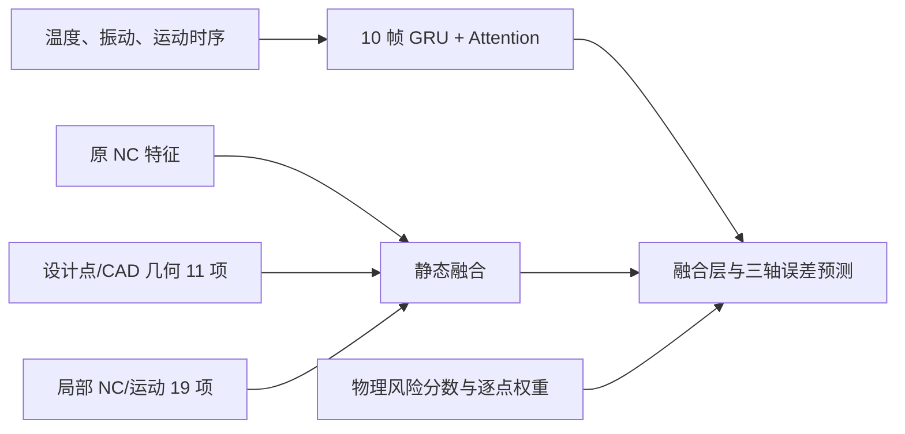

# 24 件固定数据集：91.00% 基线

本目录保存完整、独立的基线实验。`src/` 是训练时的网络、特征、风险预处理及评估代码快照；原仓库架构未修改。`data/` 含融合点、设计点、NC 程序和 STL；`source_manifest.json` 记录逐文件 SHA256 和来源，`training_parameters.json` 记录训练设置。

## 数据与结果

- 共 24 件工件，排除 1739、1892，包含 0029、1820。1673 使用同一测量表导出的实测点与设计点均满足 Z≥0 的 742 点版本。
- 按 NC 加工阶段分块，每件均有训练、验证、测试点：分别为 10,372、1,976、1,978 点。逐点身份保存在 `baseline/*_point_identities.csv`。
- 从随机初始化训练：种子 2031，10 帧时序窗，batch 128，最多 300 轮，早停耐心 60。模型选择依赖验证集。
- 三轴预测误差残差的欧氏范数 <0.04 mm 为达标。保存模型 `baseline/physical_geometry_nc_model.keras` 在测试集 **1800/1978 = 91.00%**。
- 已从本目录的代码和数据重新加载模型，测试集逐点预测最大差为 **0 mm**。原始预测、模型、预处理器、训练记录和审计文件均在 `baseline/`。



## 复现

在本目录安装 `requirements.txt` 的依赖，然后执行：

```powershell
python train_baseline.py --mode verify
python train_baseline.py --mode train
```

`verify` 根据目录内相对路径生成运行清单，核对输入哈希与训练/验证/测试点身份，重新加载保存的模型并逐点比较预测结果；`train` 用相同设置从头训练，写入 `runs/baseline_retrain/`，不覆盖保存的 91.00% 基线。运行时清单保存在被忽略的 `runtime/`。

本次上传仅包含基线实验。消融实验仍在本地，不属于本目录提交内容。
