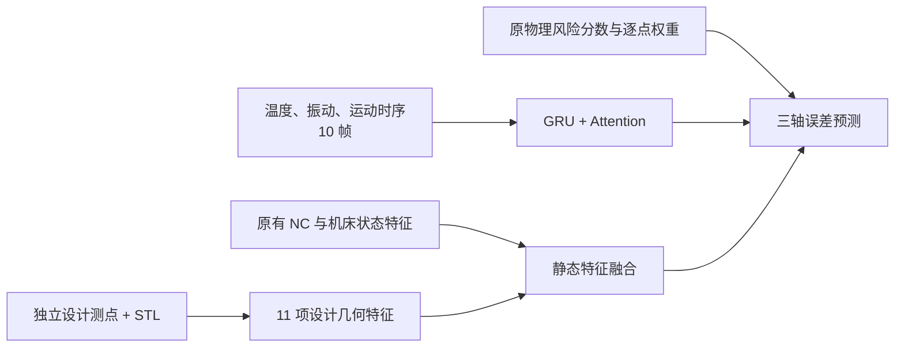

# 24 件工件：仅加入设计几何 11 项的模型

本版本沿用固定 24 件实验的 GRU-Attention 时序主干、原有 NC 融合、温度/振动输入、物理风险分数与逐点训练权重；在新增物理特征中**只启用 11 项独立设计测点/CAD 几何特征**，不把新增的 19 项局部 NC/运动及 CAD 法向交互特征送入模型。设置为 `TEE_USE_PHYSICAL_POINT_FEATURES=true`、`TEE_PHYSICAL_FEATURE_SET=geometry`。原始主干和 [91.00% 全 30 项版本](../README.md)均保留。



11 项包括设计点在工件内的归一化 XYZ、径向位置、相对顶部高度（5）；设计点到 STL 表面的间隙及有效标记（2）；CAD 表面法向 XYZ 与局部法向变化（4）。几何从**设计坐标**计算，不读取实测坐标或真实误差作为预测输入。具体计算见 [代码](../src/physical_point_features.py)。

## 数据集与训练设置

使用与全特征基线完全相同的 24 件工件、逐点标签与 NC 阶段分块划分：训练 **10,372** 点，验证 **1,976** 点，测试 **1,978** 点。1739、1892 不纳入；0029、1820 纳入；1673 使用实测/设计坐标同步按 Z≥0 过滤后的版本。每件工件都出现在三个划分中，因此这是**已见工件内不同加工阶段**的测试，不是未见工件盲测。

为避免重复存储约 160 MB 的相同数据，数据集已在本仓库同一项目内上传并由本版本直接引用：[融合 JSON](../data/fusion)、[设计点](../data/nominal)、[NC 程序](../data/nc)、[STL](../data/stl)；[逐文件 SHA256 清单](../source_manifest.json)固定了实际输入。训练和验证/测试点身份见 [基线划分文件](../baseline)。

完整参数见 [training_parameters.json](training_parameters.json)：种子 2031、10 帧窗口、batch 128、最多 300 轮、早停耐心 60、风险教师最多 100 轮，静态融合全连接层为 160/80。模型从随机初始化训练，不使用旧模型权重。保存的模型和预处理器是先前同数据同划分的“仅设计几何”消融训练产物，现作为这个独立版本原样归档；本次整理未重新训练权重。

## 固定测试集结果

三轴误差预测残差的欧氏范数 **<0.04 mm** 记为达标。

| 版本 | 达标点 | 准确率 |
|---|---:|---:|
| 全 30 项新增物理特征 | 1800/1978 | 91.00% |
| **仅新增 11 项设计几何** | **1816/1978** | **91.81%** |

两版测试点与真实标签逐点一致：几何版修正原版失败点 **51** 个，同时使原版正确点 **35** 个退化，净多 **16** 个达标点（+0.81 个百分点）。24 件中 14 件提高、7 件下降、3 件持平。测试点的物理风险分数、标记与逐点权重[逐点一致](risk_equivalence.json)。[逐工件图](per_workpiece_comparison.png)、[逐工件表](per_workpiece_comparison.csv)、[逐点状态变化](point_transitions.csv)、[完整对照摘要](comparison_summary.json)和[逐点预测](test_weighted_predictions.csv)均已保存。

按工件重采样的准确率差值 95% 区间为 **−0.21 至 +1.84 个百分点**。这个版本是在已经多次查看的同一固定测试集上选出的，91.81% 是探索性结果；是否稳定优于 91.00% 仍需换随机初始化种子或使用新工件盲测。

## 复现与文件

在项目目录安装 [requirements.txt](../requirements.txt) 后执行：

```powershell
python geometry11/train_geometry11.py --mode verify
python geometry11/train_geometry11.py --mode train
python geometry11/compare_baseline.py
```

`verify` 校验所有数据文件哈希，重载保存的[模型](physical_geometry_nc_model.keras)和[预处理器](physical_geometry_nc_preprocessing.pkl)，逐点比较预测结果；[重载验证](reload_verification.json)确认 1,978 点预测最大差为 0 mm。`train` 按相同参数从随机初始化重新训练，输出到被忽略的 `geometry11/retrain/`，不覆盖归档模型。模型输入列表见 [split_and_feature_audit.json](split_and_feature_audit.json)：80 列静态输入中，新增物理特征恰好为 11 项设计几何；时序输入为 108 列。[训练历史](training_history.csv)、[训练日志](training.log)、[验证集预测](val_weighted_predictions.csv)、[风险预处理](physical_risk_preprocessing.json)和[数据/模型哈希](package_manifest.json)见本目录。
