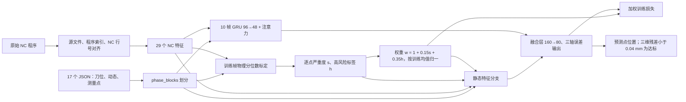

# NC 融合与物理风险预处理：81.70% 版本

本目录固定为物理风险 v1 实验。误差网络由 Exp1 GRU 注意力架构扩展，在静态分支和 10 帧时序分支加入 29 个 NC 指令/刀轨特征。训练前只根据刀具加速度、相邻刀位跳变、NC 转角和下一段长度标定逐点物理风险；连续风险分数和逐点权重进入静态分支，权重同时作用于训练损失。风险分数表示相对动态严重度，不是误差预测失败概率。



物理规则使用每个 NC 程序训练帧的 75/90/95/99 分位数。加速度或刀位跳变超过 99 分位单独触发；其他条件要求加速度与跳变、NC 转角或下一段长度共同偏高。完整布尔规则见 physical_risk.py 的 score 函数。正常点的权重也随连续严重度变化，并非固定为 1。训练前还运行原 motion_risk.py 的教师预处理以形成基础输入通道，但物理分数/权重覆盖其失败概率通道；正式训练采用物理权重。首次无缓存运行会训练 5 折教师，耗时明显增加。

## 数据与复现

输入是仓库内 data/hybrid_json 的 17 个 JSON（9,908 原始点）。NC 原程序不在仓库，需把本地 NC 文件路径填写到 nc_manifest.json（格式见 nc_manifest.example.json），或者设置 TEE_NC_MANIFEST 指向自己的映射文件。模型 16 的两个原始程序索引须分别映射。缺少这些原始 NC 文件无法从公开仓库完整重训。

在项目根目录建立可用的 .venv 并安装仓库所需依赖后运行：

```powershell
& .\lstm_nc_risk\train_physical.ps1
```

脚本采用 phase_blocks、种子 2031、10 帧序列，训练/验证/测试可预测点 6,863/1,279/1,279，batch 128、最多 300 轮、早停 patience 60。完整参数见 training_parameters.json。训练输出位于 results/exp1_nc_physical_risk_20261015。published_results 保存本次完成训练的模型、预处理工件、逐点预测、训练曲线数据及报告；新运行可能因平台和随机计算产生微小差异。

## 已保存结果

达标定义为预测点与真值三维距离小于 0.04 mm。上一版 NC 融合网络为 1,038/1,279（81.16%）；物理风险重新训练网络为 **1,045/1,279（81.70%）**，净增 7 点。原来失败的 241 点有 57 点变为正确，原来正确的 1,038 点有 50 点变为超界。

测试集 **45/1,279（3.52%）** 被标物理高风险。其中本次模型失败点 13/234 被标记，正确点 32/1,045 被标记；与上一 NC 网络比较，失败点 15/241、正确点 30/1,038 被标记。最佳验证达标率 86.24%（第 216 轮）。published_results/evaluation_summary.json、report.md、comparison.png 和逐点 CSV 提供核对依据。reference_previous_nc_test_predictions.csv 固定上一版 NC 网络的逐点预测，避免依赖未入库的旧实验目录。

同一测试集在此前多次实验中已被查看，所以本次比较是探索性结果，不是独立新工件泛化评估。物理风险本身仍需独立工艺或机床事件标签验证。
